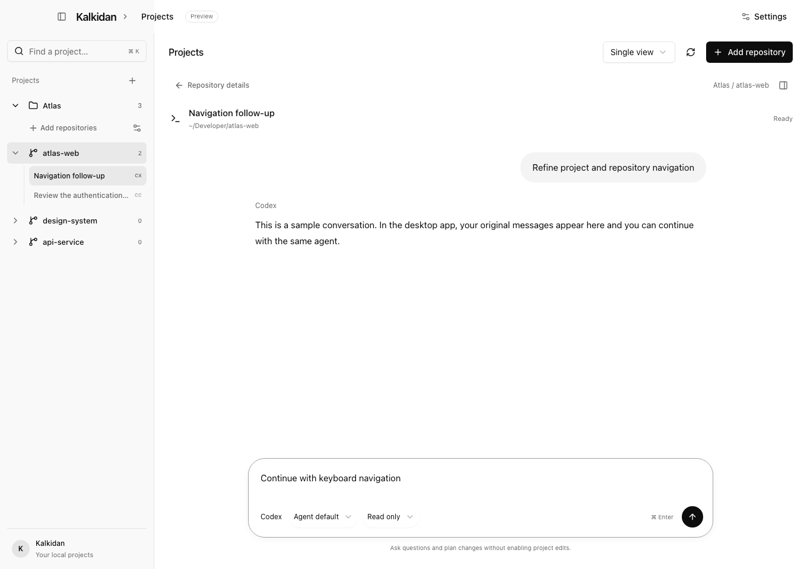
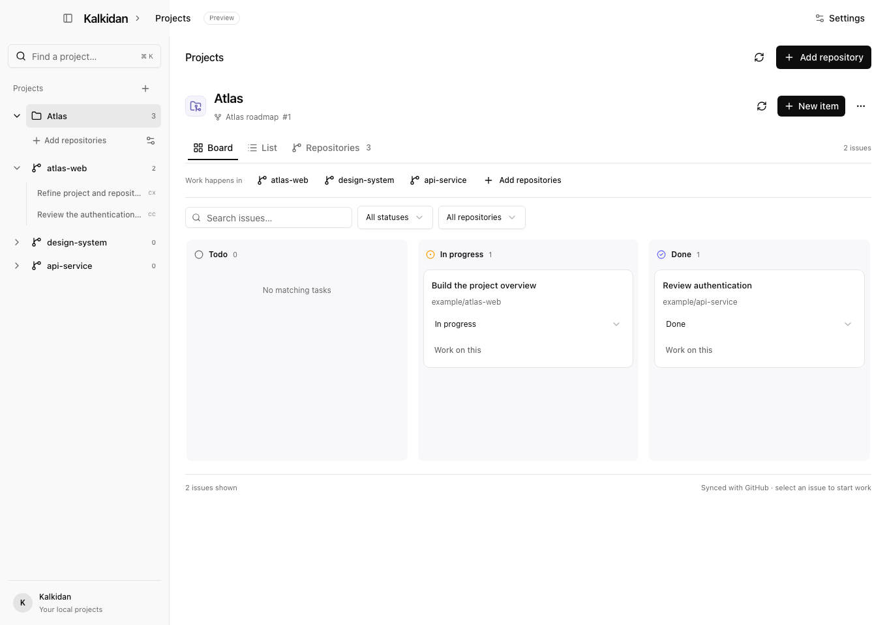

<div align="center">

# Kalkidan

**Your projects. Your agents. One place to keep building.**

A macOS app for organizing repositories, continuing Codex and Claude Code conversations,<br />
and managing project work through GitHub Projects.


[](LICENSE)

[Get started](#get-started) · [The workflow](#the-workflow) · [GitHub Projects](#github-projects) · [Contributing](#contributing)

</div>



<p align="center"><sub>Actual interface, shown with sample data in browser preview mode.</sub></p>

## Keep the work together

A project can span a frontend, an API, shared packages, and dozens of agent conversations. Kalkidan brings them into one project view, so you can find the right repository, pick up a session, and keep its tasks close by.

- **One tracker, related repositories.** Connect each project to a GitHub Project and keep its work in the repositories that belong to it. Add local folders or browse and clone GitHub repositories from the app.
- **Codex and Claude Code, in the same interface.** Start or resume conversations with streaming responses, model selection, expandable tool output and changes, and in-app permission approvals.
- **Sessions you can find again.** Search, rename, pin, collect, annotate, and archive conversations without rewriting their provider history.
- **A tracker connected to the work.** Use a compact tracker inspired by Linear: status columns and repository filters. Move tasks between statuses and open them with an agent. Repository overviews also show the linked project board beside the repository’s session controls.
- **Room to focus.** Use a dark desktop interface with project navigation, pinned conversations, and a focused reading area. Switch between project management and conversations. Open tabs retain drafts and running responses while you navigate.
- **Git close at hand.** Inspect branches and changes, view worktrees, or create a branch and worktree for independent work.

Built with TypeScript, Electron, React, Tailwind CSS, and shadcn/ui.

## Get started

Kalkidan is in early development. Run it from source, or build a macOS installer locally.

### Prerequisites

| Requirement | Used for |
| --- | --- |
| macOS | Desktop app and native integrations |
| Node.js **22.12+** and npm | Installing dependencies and running the app |
| Git | Repository status and worktrees |
| Codex CLI and/or Claude Code CLI | Conversations with the agents you use |
| GitHub CLI (`gh`) | Required to connect or create projects; also handles repository browsing and cloning |

Sign in to each agent CLI you want to use and verify that `codex` or `claude` runs in your shell. Kalkidan uses that installation and its existing authentication.

```sh
git clone https://github.com/verdictan/kalkidan.git
cd kalkidan
npm ci
npm run dev
```

### Your first project

1. Choose **New project**, and select or create its GitHub Project.
2. Use **Add repositories** to select local folders or clone from GitHub. Every repository belongs to a project.
3. Select a repository and start a **Codex** or **Claude Code** conversation, or expand the repository to resume an existing session.
4. Choose a model and permission mode, write your message, and press **⌘ Enter**.
5. Open a tracker task to start work in the current checkout or a new worktree. General conversations can stay unlinked; use **Link task** to attach context later.

Want to explore the interface first? Run `npm run preview` and open `http://127.0.0.1:5173`. This is a browser preview with sample data; native actions require the desktop app.

## Remote projects over SSH

Keep Kalkidan on your Mac and run repositories, Codex, and Claude Code on a remote Linux or macOS host.

1. In **New project**, set **Where work runs** to **Remote SSH host**.
2. Add an SSH config alias or `user@hostname`, then choose **Check connection**.
3. Choose **Install agent & connect**. Kalkidan uploads its bundled agent into `~/.local/share/kalkidan/agents/` on the host and starts it over SSH.
4. Connect or create the project's GitHub Project as usual.
5. Use **Add repositories** to browse remote folders or clone a GitHub repository into an absolute path on the host.

The host needs Node.js **22+**, Git, and the agent CLIs you use, available on the noninteractive SSH shell's PATH. Configure key-based authentication and verify the host key with your normal SSH client first. Custom ports, identity files, and jump hosts belong in `~/.ssh/config`. Password prompts and new host-key confirmations are not handled inside Kalkidan.

The connection uses OpenSSH with strict host-key checking. Agent installation does not require sudo or expose a public server port. Codex and Claude use their own credentials and settings on the host; private repository cloning requires Git credentials there too. GitHub Projects authorization stays on the Mac.

Remote session history, conversations, approvals, commands, worktrees, and Git diffs use the selected host. Identical folder paths on different hosts remain separate. Remote projects show an SSH label; offline requests fail explicitly rather than running on the Mac.

Manage saved connections in **Settings → Remote hosts**. Reconnect after restarting the app. Disconnecting, updating the remote agent, or closing Kalkidan stops active remote work; the agent is not a persistent background service. Saved provider history remains on the host.

Browser previews run on the Mac. Use a URL reachable from the Mac, or configure SSH port forwarding yourself for a remote development server. Automatic port forwarding is not included.

## The workflow

```text
Project
├── Repository
│   ├── Codex sessions
│   └── Claude Code sessions
├── Another repository
│   └── More sessions
└── Connected GitHub Project
    └── Tasks linked to agent sessions
```

**Projects organize the work.** A project groups related repository folders around a GitHub Project. Existing unlinked projects stay accessible with a prompt to connect. Each repository has its own Git state, worktrees, and conversations. There is no extra workspace layer to manage.

**Conversations stay in Kalkidan.** Select a session from its repository to continue with the original agent. Model choices include the agent default, available provider options, and a custom model ID. Agents share repository files while keeping their own conversation context, configuration, and credentials.

**You control edits.** Conversations default to **Read only**. Choose **Allow project edits** when you want the agent to change files. Existing agent rules and settings still apply. When the provider requests command, file, or tool permissions, an approval card offers **Allow once** or **Deny**. Codex permission grants that last for the turn are explicitly labeled **Allow for this turn**. Unanswered requests expire when their turn stops or ends. Unsupported interactive request types are declined.

**Bring evidence into a conversation.** The titlebar’s **Terminal**, **Browser**, and **Git diff** buttons open a tools pane beside the chat. Drag the divider to resize it, use its arrow keys for smaller adjustments, or double-click to reset. The chat, composer, and draft stay visible while you work. The tools pane has browser-style tabs: use **+** (⌘T) to add independent terminals, browser pages, or changes views; close tabs individually, or hide the pane without ending its sessions. Use ⌘` for Terminal and ⌘⇧G for Changes. Attach terminal output, Git diffs, or page annotations as removable context; nothing is sent to the agent until you send the message.

The embedded Chromium browser includes back/forward navigation, reload, element annotations, find in page, page zoom, a device toolbar with presets and custom dimensions, PNG screenshots, and the native print dialog. Links that request another window open in a new tool tab. Its **⋯** menu also manages downloads, searchable history, the home page, history recording, and clearing cache, cookies/site data, or saved passwords. Browser data stays in Kalkidan’s separate profile.

Import cookies from a JSON array and passwords from a Chrome/Firefox-style CSV with `url`, `username`, and `password` columns. Passwords are encrypted using the operating system’s secure storage. Choose **Fill login** for a saved credential on its exact origin; the app fills the visible form but does not submit it. Direct import of Chrome’s protected profile, Chrome Sync, and automatic capture of new passwords are not included.

These tools require the Electron desktop app. The interactive terminal uses xterm.js and a real pseudo-terminal. It requires Python 3 on the execution machine (your Mac or the selected SSH host), using only its standard library. Shell state persists until you choose New shell, close the conversation tab, disconnect the host, or quit the app. Browser annotations capture text, selectors, URLs, and element bounds rather than screenshots. Commands and browser previews close when the app window closes.

**Navigation keeps your place.** Collapse the project tree to focus, use **⌘K** to search, and switch between project details and conversations. Drafts and running responses survive switching views within the app. Closing the app window stops active responses; saved provider history remains available.

Use a repository's **Sessions** tab to manage titles, pins, collections, notes, and archives. Archiving in Kalkidan hides a conversation locally without deleting the provider's history.

## GitHub Projects

Connect a project to a GitHub Projects v2 board on **github.com**. Choose an existing board from your account or organization, create one, or connect by URL.

If authorization is needed, Kalkidan starts the GitHub CLI sign-in or scope-refresh flow, opens GitHub in your browser, and shows the device code in the app. GitHub CLI manages the credentials.

Once connected, you can:

- Open a project directly to its **Board**, search tasks, and filter by status or repository.
- Drag cards between columns or use a card’s keyboard-accessible **Move to** menu.
- Create draft items and add existing issues or pull requests.
- Select a task title, choose a repository and checkout, then open a conversation with an agent. Review the prompt before sending; **Back to project board** preserves your filters.
- Resume sessions linked to a task.

A linked task moves to **In progress** when its agent starts responding. To finish a task, choose **Review task completion**, inspect **Review changes**, then explicitly **Mark task Done**. Finishing a response never opens this confirmation automatically. Those transitions require matching status options on the board. Task changes sync to GitHub. Use **GitHub project** at the bottom of the sidebar to replace a connection; linked projects cannot be disconnected into local-only projects.

<details>
<summary>See the tracker board</summary>




*Shown with sample data.*

</details>

## Local data and privacy

Kalkidan has no hosted backend. It stores project and session organization on your Mac. Agent operations use installed CLIs on the selected machine, while GitHub project operations use the Mac’s GitHub CLI. Those tools connect to their respective services using your existing accounts.

When you send a task-linked message, the selected agent receives the task description, project name, member repository paths, and linked GitHub Project URL alongside your prompt.

### Project Board and Docs

Click a project name to open its board, or its **Docs** entry to open the wiki. Docs supports a nested page tree, title and content search, page moves, and a rich-text editor with live Markdown shortcuts, a slash-command block menu, selection formatting, and a read-only view. Markdown source is available from the document actions menu. Changes save automatically; Cmd/Ctrl+S also saves. The editor uses one centered document canvas; secondary actions such as moving pages are in the document menu.

Each project owns a folder, chosen in Create project or assigned under `~/.kalkidan/projects/<project-id>/`. The folder contains `docs/`, `repos/`, and `worktrees/`. New clones and worktrees are placed there automatically; existing repositories remain linked at their original paths. The location is shown in Manage project. Desktop pages are Markdown files at `<project-folder>/docs/<page-id>.md`. A small HTML comment stores the page title and parent ID. Files can be edited externally; revision checks prevent the app from silently overwriting newer disk content. Unsaved drafts are retained locally for recovery. Deleted leaf pages move to the project's `.trash` folder; move or delete subpages before deleting their parent. For SSH projects the project folder and docs live on the remote host. Existing local docs are copied there on first access, retaining the original files as a recovery copy. Local project docs migrate into their project folder on startup with the same recovery behavior. Browser preview docs use local browser storage.

<details>
<summary>Storage and session discovery</summary>

App metadata and Electron browser storage live in `~/.kalkidan/`:

| File | Contents |
| --- | --- |
| `remote-hosts.json` | Saved SSH host profiles and installed agent versions; no SSH credentials |
| `projects.json` | Registered repository folders and metadata |
| `project-groups.json` | Project groupings and GitHub Project connections |
| `sessions.json` | Session titles, pins, collections, notes, archives, and task links |

On first launch, an existing `kalkidan`, `common-ground`, or `Common Ground` directory in the operating system’s application-data folder is moved to `~/.kalkidan`. An existing `~/.kalkidan` is never overwritten. Removing a repository from the library does not delete its files.

Session discovery reads Codex's local SQLite index with a JSONL fallback, and Claude Code's local project conversation files. It respects `CODEX_HOME` and `CLAUDE_CONFIG_DIR`, which default to `~/.codex` and `~/.claude`. There is no session-count cap. Source-archived Codex threads and Claude subagent logs are excluded; sessions archived in Kalkidan are hidden from the active list.

These readers adapt to local provider storage formats, so unsupported metadata may prevent a session from appearing. Resuming requires its working folder to exist. JSONL transcript previews read up to the last 4 MiB and show up to 500 user/assistant messages; tool results and internal reasoning are omitted. Preview limits do not replace the context used by the agent when resuming.

The Electron renderer is sandboxed and context isolated, with no direct Node.js access. Native operations run through a typed preload bridge.

</details>

## Development

```sh
npm run dev             # Start Vite and Electron
npm run build           # Type-check and build the renderer and desktop app
npm test                # Unit and integration fixtures
npx playwright install chromium
npm run test:ui         # Browser interaction tests
npm run test:desktop    # Electron IPC and persistence smoke test
npm run dist:mac        # Build macOS DMG and ZIP into release/
```

Renderer changes hot reload. Restart `npm run dev` after changing files under `electron/`.

Codex uses [App Server](https://developers.openai.com/codex/app-server) for streaming turns and approvals. Claude Code uses its bidirectional stream-JSON control protocol, following the [official Agent SDK transport](https://github.com/anthropics/claude-agent-sdk-python/tree/main/src/claude_agent_sdk/_internal). Both use installed CLI authentication.

Tests use sample data, fixture executables, temporary directories, and simulated SSH transport. Remote checks do not validate a live SSH server or deployment. They do not validate a live authenticated agent turn or mutate live GitHub Projects. Packaging runs on macOS; signed and notarized distribution requires your own signing configuration. Local builds are unsigned unless you configure it.

```text
electron/             Native operations, agent processes, GitHub, persistence
src/components/       Projects, repositories, conversations, and tracker views
src/components/ui/    Shared shadcn/ui components
src/demo.ts           Browser preview adapter with sample data
src/types.ts          Shared renderer and desktop API types
tests/                Unit, browser, and Electron checks
```

## Troubleshooting

<details>
<summary>Development server: port 5173 is already in use</summary>

The development command expects Vite at `127.0.0.1:5173`. Stop the previous Kalkidan development process, or the other server using that port, then run `npm run dev` again.

</details>

<details>
<summary>Codex reports “already has an active writer”</summary>

Codex allows one writer per session. Stop the task and close that session in the client that owns it; an idle session in another app can still hold the lock. If needed, quit the owning client, then choose **Retry session** in Kalkidan. Kalkidan restores the unsent message so you can try again. It does not claim to identify the owning client when Codex does not report it.

</details>

<details>
<summary>GitHub Projects needs additional access</summary>

Use the authorization action in Kalkidan to grant Projects access through your browser. If you prefer to authorize manually:

```sh
gh auth login
gh auth refresh -h github.com -s project
```

Your account must also have access to the repository or organization project you want to use.

</details>

<details>
<summary>Node or Electron does not start</summary>

Check that your shell uses Node.js 22.12 or newer. For Homebrew's `node@22` on Apple Silicon:

```sh
export PATH="/opt/homebrew/opt/node@22/bin:$PATH"
```

If your package manager skipped Electron's installation script, allow its postinstall or run:

```sh
node node_modules/electron/install.js
```

</details>

Current scope excludes cloud-only sessions, cross-agent conversation conversion, worktree removal, GitHub Enterprise, and classic GitHub Projects. The explicit **Terminal** repository shortcut opens macOS Terminal; agent conversations run inside Kalkidan.

## Contributing

Issues and pull requests are welcome. For larger changes, open an issue first to discuss the intended workflow.

Include reproduction steps, your macOS and CLI versions, and relevant logs when reporting a bug. Remove credentials and private repository or conversation content before posting. For UI changes, include screenshots; for behavior changes, add focused coverage and run the relevant checks above.

## License

[MIT](LICENSE) · Copyright © 2026 Verdictan.com

### Conversation actions

The conversation’s titlebar menu supports rename, pin/unpin, a separate side chat,
archive, and native forks into the current checkout or a new Git worktree. Forks
inherit the provider’s saved conversation and receive a new session ID on the first
message. Send a draft’s first message before exporting or forking it.
Archiving hides a conversation in Kalkidan; restore it from the repository’s archived sessions.

**Share** exports Markdown or a standalone HTML file using the macOS save dialog.
HTML exports escape conversation content. Exports contain the transcript available
to Kalkidan and indicate when earlier content was truncated. No public link is created.
The Copy submenu copies the transcript, session ID, or repository path. Saved chats
can open in another Kalkidan window; local repositories can open in Finder, VS Code,
or Cursor (the selected editor must be installed). Remote folders stay on their SSH host.

Git change review includes a changed-file selector, previous/next navigation, per-file
addition/deletion counts, and individual file attachments. Untracked text files have
bounded previews; binary files and symlinks are labelled without reading their targets.
Large file previews and patches display truncation notices.

## Extending Kalkidan

Project trackers use a provider-neutral domain and an explicit adapter registry. GitHub is the included adapter; additional providers can supply their own authentication, project discovery, board data, and supported operations. Project workflow statuses can be configured from the board's **Workflow** action.

The desktop and SSH service share agent runtime contracts. Domain types, capability APIs, runtime configuration, persistence, and feature styles have separate modules. See the [architecture and extension guide](docs/architecture.md) for adapter registration, migration behavior, configuration, test commands, and current limits.


Repository overview refreshes fetch the selected repository's sessions and Git state together; they do not poll the full library or unrelated SSH hosts. Overlapping requests share one operation, and cached repository content remains visible during revalidation.

Docs navigation loads page metadata first and fetches Markdown when a page opens. The desktop/remote service caches up to 32 document bodies, revalidating file identity, size, modification time, and change time before reuse. Ordinary saves validate only the edited document; page moves validate the ancestor chain. Writes serialize per project, so separate projects can save concurrently. Initialization is cached on the owning host with a 30-second lifetime, identity checks, and failure invalidation.

History discovery still reconciles directory entries and file metadata so new, deleted, and externally edited sessions are detected. Unchanged JSONL files reuse parsed metadata. The Codex index remains authoritative. Run `npx tsx --test tests/io-performance.test.ts` for read-count, payload-size, cache-invalidation, and queue-isolation checks.

## Jenkins CI and release builds

The root `Jenkinsfile` uses the existing Verdictan `keeptrusts` shared library,
`linux-untrusted` worker for validation, and the `verdictanNodeToolchain` helper
on `macos-untrusted` for release packaging. Node and npm are pinned in
`.node-version`, `package.json`, and `ci/Dockerfile`. PRs, `main`/`master`, and discovered version
tags run CI; standalone feature branches wait for a PR. GitHub Actions workflows
have been removed.

`scripts/ci.sh` installs from the lockfile and runs architecture checks, all unit
tests, the production build, the focused browser regression suite, desktop document
persistence tests, and the isolated remote-agent protocol test. Workspaces and
job-local caches are cleared between builds. `scripts/ci-container.sh` runs the
checks through the existing untrusted BuildKit service using `ci/Dockerfile`.
The container supplies Xvfb for Electron and exports test results even on failure.
Dependency layers can be reused, while each build executes validation again.
Electron runs as a non-root user; its Linux sandbox is disabled only inside this
isolated CI container because nested Chromium sandboxing is unavailable there. Jenkins retains 30 build records and
up to three sets of artifacts for seven days.

For version-tag builds, `scripts/package-release.sh` verifies that the tag matches
both `package.json` and the checked-out commit. After successful validation, it
builds unsigned Apple Silicon and Intel DMG/ZIP installers and `SHA256SUMS.txt`.
Download these from the Jenkins build's artifacts. Failed validation prevents
packaging. Branch and PR builds receive no publishing, deployment, or signing
credentials and never publish GitHub releases.

### Connect the repository to the existing controller

The live multibranch job is [Verdictan / Kalkidan](https://jenkins.dennisotugo.com/job/verdictan/job/kalkidan/). Its Job DSL definition is saved in the controller configuration. Builds use the existing `verdictan-ci` identity.

Create a GitHub multibranch pipeline for `verdictan/kalkidan`, using the existing
`github-scm` credential and `Jenkinsfile` script path. Enable origin PR, main-branch,
and tag discovery, and configure the tag build strategy to build version tags.
The controller must already provide the globally configured `keeptrusts` library
an available `linux-untrusted` agent with `buildctl` and access to the existing
untrusted BuildKit service, and a `macos-untrusted` agent for release tags.
Validation uses its own Linux virtual display; macOS packaging does not require
a desktop login. Node/npm for packaging come from the shared toolchain helper.

Scan the job after merging this Jenkinsfile. The existing `v0.1.0` tag points to
the earlier GitHub Actions configuration; do not move that tag. A new release
version/tag must include the Jenkinsfile. The repository job archives installers only.

A separate controller-owned release job checks `main` and `master` every two
minutes. It builds each new first-parent commit in order, including intermediate
commits between checks, and publishes Apple Silicon and Intel DMG/ZIP installers
to [Kalkidan releases](https://github.com/verdictan/packages/releases?q=kalkidan).
The first run starts at the current branch head. Failed builds stop publication;
the next run retries before processing later commits. Rewritten published history
requires reconciliation rather than silently skipping commits.

Each release has a unique `VERSION-build.TIMESTAMP.COMMIT` version. The latest
Kalkidan release and SHA-256 checksums are recorded in
[kalkidan.json](https://github.com/verdictan/packages/blob/main/kalkidan.json).
The shared package repository's global latest pointer remains owned by the CLI.
The release job updates the architecture-specific Homebrew cask automatically:

```sh
brew install --cask verdictan/tap/kalkidan
# Later:
brew upgrade --cask kalkidan
```

Installers are currently unsigned macOS builds. This flow does not publish Linux
APT/RPM packages or Apple signing/notarization. Publication credentials are only
available to the controller-owned publisher, after the untrusted build completes.

## Dependency updates

Renovate runs daily through the existing Jenkins maintenance job. Its repository
configuration is in `renovate.json`, and its Dependency Dashboard tracks pending
updates. npm patch/minor updates are grouped, major upgrades remain separate,
and lockfile maintenance runs weekly. Node.js and npm toolchain rules also cover
the CI container when those files are present on the default branch.

Updates normally wait seven days after release. Renovate opens at most three
concurrent PRs, with at most two new PRs per hour. Automerge is disabled; review
and merge updates explicitly. Once an update reaches `main` or `master`, the
normal build and release pipeline publishes the resulting app.
