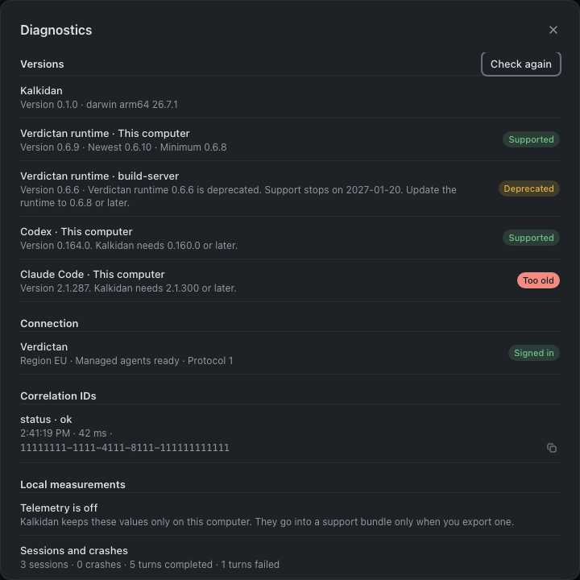

# Kalkidan User Guide

## Features

A project groups related repositories and agent conversations. Each project can connect to a GitHub Project.

Use Kalkidan to:

- Add local repositories or clone repositories from GitHub.
- Start or continue Codex and Claude Code conversations.
- Select models and approve agent operations.
- Search, rename, pin, organize, and archive conversations.
- Manage tasks on a board with status columns and repository filters.
- Connect tasks to agent conversations.
- Examine Git changes and worktrees.
- Create branches and worktrees for separate tasks.
- Write project documents in a Markdown editor.

Open conversation tabs keep drafts and active responses when you change views.

Kalkidan uses TypeScript, Electron, React, Tailwind CSS, and shadcn/ui.

## Get started

Kalkidan is in early development. You can install a release, run the source code, or build an installer.

### Install a release

Use Homebrew to install the app:

```sh
brew install --cask verdictan/tap/kalkidan
```

To install a later version, run:

```sh
brew upgrade --cask kalkidan
```

You can also download installers from [Kalkidan releases](https://github.com/verdictan/packages/releases?q=kalkidan). Windows and macOS installers are unsigned. See [Jenkins CI and release builds](#jenkins-ci-and-release-builds) for release details.

### Prerequisites

| Requirement                                               | Purpose                                                           |
| --------------------------------------------------------- | ----------------------------------------------------------------- |
| macOS, Windows 10 (1809+) or Windows 11, or desktop Linux | Run the desktop app.                                              |
| Node.js **24.21.0+** and npm **12.2.0**                   | Install dependencies and run the source code.                     |
| Git                                                       | Read repository status and manage worktrees.                      |
| Codex **0.160.0+** or Claude Code **2.1.300+**            | Run the selected agent. You can install both.                     |
| GitHub CLI (`gh`)                                         | Connect projects and find or clone repositories.                  |
| Python 3                                                  | Run interactive terminals on macOS or Linux. Windows uses ConPTY. |

Install Codex 0.160.0 or later, or Claude Code 2.1.300 or later. Kalkidan sets
these minimum versions. Verdictan does not pin agent versions. A prerelease counts
by its number: Codex `0.163.0-alpha.10.2` meets the minimum. Open **Settings** ›
**Agents** to see the version of each agent. The row shows **Meets the minimum**
or **Update required**. Kalkidan reads the version before each managed launch.
When the version is older than the minimum, or Kalkidan cannot read it, the chat
does not start. The message tells you to update the agent and gives a button that
opens **Settings** › **Agents**.
Complete Verdictan setup for the selected execution host. Kalkidan requires the
managed runtime, account authorization, and launch checks. It does not use a
native CLI login as a fallback. Managed native execution is available on accepted
macOS and Linux hosts. Windows managed execution stays blocked.

Kalkidan runs agents only through managed Verdictan agents. This rule applies to
new sessions, resumed and forked conversations, automatic dispatch, SSH hosts,
subscription access, organization provider connections, and Memory extraction.
The browser preview does not start agents. When a check stops a launch, the
message names the cause and gives a button that opens the related step in
Settings: the region, the sign-in, the managed agent setup, the managed runtime,
or the agents. The Terminal opens a shell only; it does not start an agent.

Managed agent setup shows the team, policy, provider connection, and account
names that Verdictan sends. When Verdictan does not send a name, Settings shows
a generic label, for example "Default team", "Policy 1", or "Your account". IDs
stay internal.

Verdictan keeps one default policy for Kalkidan in each organization. When an
administrator opens the managed agent setup for the first time, Kalkidan makes
this policy. The **Policy** list shows it as **Kalkidan default** and selects it.
You can select a different policy when Verdictan lists one. If your organization
has no default policy, or you cannot read it, the setup tells you to ask an
organization administrator.

Verdictan keeps one usage history for chats and tasks. To see the history of a
chat, open **Chat actions** (**⋯**) and select **Usage history…**. For a task,
open the project's **Insights** page, then **Managed agent services**. Each row
shows the policy decision, the model, the tokens, the time, and the settlement.
A missing value is unknown. It is not zero. Select **Load again** to see new
requests and late settlement corrections.

### Run the source code

Run these commands in sequence:

```sh
git clone https://github.com/verdictan/kalkidan.git
cd kalkidan
npm ci
npm run dev
```

### Create your first project

1. Select **New project**.
2. Select or create a GitHub Project.
3. Use **Add repositories** to add local folders or clone repositories from GitHub.
4. Select a repository.
5. Start a **Codex** or **Claude Code** session, or select an existing session.
6. Select a model.
7. Select a permission mode.
8. Write your message.
9. Press **Enter** to send the message. Press **Shift+Enter** to start a new line.

You can write the next message while the agent responds. **Send** is available when the response stops.

Each repository belongs to a project. You can open a board task in the current checkout or a new worktree. Use **Link task** to connect an existing session to a task. Use **Unlink task** to remove the link. The task stays in the tracker.

### Open the browser preview

1. Run `npm run preview`.
2. Open `http://127.0.0.1:5173`.

The preview uses sample data. Native operations require the desktop app.

## Remote projects over SSH

Kalkidan runs on your computer. Repositories and agents can run on a remote Linux or macOS host.

### Prepare the host

Install Node.js **22+**, Git, and the required agent CLIs on the host. These commands must be on the noninteractive SSH shell's `PATH`.

Configure SSH key authentication. Verify the host key with your SSH client before you connect through Kalkidan. Put custom ports, identity files, and jump hosts in `~/.ssh/config`.

Kalkidan uses OpenSSH with strict host-key checks. It cannot answer password prompts or confirm new host keys. Agent installation does not require `sudo` or a public server port.

### Connect the host

1. Select **New project**.
2. Set **Where work runs** to **Remote SSH host**.
3. Enter an SSH configuration alias or `user@hostname`.
4. Select **Check connection**.
5. Select **Install agent & connect**.
6. Connect or create the GitHub Project.
7. Use **Add repositories** to select remote folders or clone a repository to an absolute path.

Kalkidan installs its agent in `~/.local/share/kalkidan/agents/` on the host. It starts the agent through SSH.

### Credentials and remote operations

Codex and Claude Code use credentials and settings on the remote host. Private repository clones also require Git credentials on that host. GitHub Projects authorization stays on your computer.

Session history, conversations, approvals, commands, worktrees, and Git diffs use the selected host. Identical paths on different hosts refer to separate folders. Remote projects have an SSH label. Requests to an offline host return an error. They do not run on your computer.

Use **Settings → Remote hosts** to manage connections. Reconnect after you restart Kalkidan.

Disconnecting, updating the remote agent, or closing Kalkidan stops active remote work. The agent does not run as a persistent background service. Saved conversation history stays on the host.

Browser previews run on your computer. Use a URL that your computer can access. If necessary, configure SSH port forwarding for the remote server. Kalkidan does not configure port forwarding automatically.

## The workflow

```text
Project
├── Repository
│   ├── Codex sessions
│   └── Claude Code sessions
├── Another repository
│   └── More sessions
└── Connected GitHub Project
    └── Tasks linked to agent sessions
```

A project groups related repository folders. Each repository has its own Git state, worktrees, and conversations. Existing projects without a GitHub connection remain available. Kalkidan shows a prompt to connect them.

### Conversations and permissions

Select a session from its repository to continue with the original agent. Select the default model, an available model, or a custom model ID. Agents use the same repository files. Each agent keeps separate conversation context, settings, and credentials.

Conversations start in **Read only** mode. Select **Allow project edits** to permit file changes. The agent's existing rules still apply.

Permission requests show **Allow once** and **Deny** actions. Codex can also show **Allow for this turn**. Unanswered requests expire when the turn stops or ends. Kalkidan declines unsupported interactive requests.

If a permission request is not in view, a banner above the message box shows "The agent is waiting for your approval". Select **Review** to go to the request.

### Navigation and session management

Use **⌘K** to search. Collapse the project tree when necessary. Drafts and active responses remain available when you change views. Closing the app window stops active responses on this computer. Responses on an SSH host continue on the host. Kalkidan attaches to them again when it connects to the host. Saved conversation history remains available. When you start Kalkidan again, **Open chats** shows the saved chats that were open. A chat is saved when the agent starts. If the agent does not start, the chat is not saved and the error card tells you. When you quit Kalkidan, that chat and its message close. Select **Try again** before you quit.

Use the repository's session list to manage titles, pins, collections, notes, and archives. Select a session title to resume it. Select **Organize** to change its settings. Kalkidan keeps the selected view and filters for each repository. Archiving hides a session in Kalkidan. It does not delete the agent provider's history. Restore a session from the repository's archived sessions.

The titlebar shows the repository name and the session title. Select the repository name to go back to the repository.

### Session actions

The titlebar menu lets you rename, pin, unpin, or archive a session. Kalkidan asks you to confirm before it archives a session. You can also open a separate side session.

| Action           | macOS | Windows and Linux |
| ---------------- | ----- | ----------------- |
| Rename           | ⌥⌘R   | Ctrl+Alt+R        |
| Pin or unpin     | ⌥⌘P   | Ctrl+Alt+P        |
| New side session | ⌥⌘S   | Ctrl+Alt+S        |
| Archive          | ⇧⌘A   | Ctrl+Shift+A      |

These shortcuts do not operate while you type in a text field or in the terminal.

A native fork copies the saved session into the current checkout or a new worktree. It receives a new session ID after its first message. Send a draft session's first message before you export or fork it.

Use **Share** to export Markdown or a standalone HTML file through the macOS save dialog. Exports contain the available transcript. A notice identifies truncated content. HTML exports escape session content. Exporting does not create a public link.

The **Copy** submenu copies the transcript, session ID, or repository path. You can open saved sessions in another Kalkidan window.

Local repositories can open in the file manager (Finder, File Explorer, or the Linux file manager), VS Code, or Cursor. The selected editor must be installed. Remote folders stay on their SSH host.

### Terminal, browser, and Git tools

Use **New tool tab** (**+**) in the titlebar to open the tools pane. The **Tools** tab shows **Browser**, **Terminal**, and **Changes**. The session and draft remain visible.

- Drag the divider to change the pane width.
- Use the divider's arrow keys for small adjustments.
- Double-click the divider to reset its position.
- Use **+** or **⌘T** (**Ctrl+T** on Windows and Linux) to add a tool tab.
- Use **Control+\`** on macOS or **Ctrl+\`** on Windows and Linux to show or hide Terminal. On macOS, Command+\` changes windows.
- Use **⇧⌘G** (**Ctrl+Shift+G** on Windows and Linux) to open Changes.
- Use **Hide tools** to hide the pane.

Each tab has a separate terminal, browser page, or changes view. To close a tab, select its **×** button, or focus the tab and press **Delete**. Kalkidan asks you to confirm before it closes a terminal tab, because the shell stops. Hiding the pane keeps its tabs open.

The changes view shows a list of changed files with added and removed line counts. Select a file to show its diff. The diff shows the old and new line numbers. Use **Attach file to message** or **Attach all changes to message** to add changes to your draft.

Attach terminal output, Git diffs, or page annotations to a message. You can remove attachments before you send it. The agent receives the attachments when you send the message.

These tools require the Electron desktop app.

#### Interactive terminal

The terminal uses xterm.js and a real pseudo-terminal. It requires Python 3 on your computer or the selected SSH host. It uses only the Python standard library.

The terminal gets focus only when you open it. The shell uses the Tab key for completion. Press **F6** to move focus from the terminal to the tool tabs.

Shell state remains available until you select **New shell** or close the terminal tab. A shell on this computer also stops when you quit Kalkidan. A shell on an SSH host continues when the connection stops or Kalkidan quits. When the terminal opens again, it shows the recent output of that shell. Kalkidan asks you to confirm before **New shell** stops the current shell. Commands and browser previews on this computer stop when the app window closes.

When you quit Kalkidan, or close its last window, while agent runs or shells work on SSH hosts, Kalkidan shows them for each host:

- **Keep running** leaves the work on the hosts. This is the default. Escape does the same.
- **Stop all** stops the runs and closes the shells, then Kalkidan quits.

Select **Don't ask again** to quit without this question. To see the question again, turn on **Ask before quitting while SSH work runs** in **Preferences › Connections**.

The repository's **Terminal** shortcut opens macOS Terminal. Agent sessions run inside Kalkidan.

#### Browser

The Chromium browser supports navigation, reload, page search, zoom, element annotations, PNG screenshots, and printing. Its device toolbar supports preset and custom dimensions. Links that request another window open in a new tool tab.

Use the **⋯** menu to manage downloads, history, and the home page. You can also control history recording or clear history, cached files, cookies, site data, and saved passwords. Kalkidan asks you to confirm before it clears data. Clearing cookies signs you out of sites. Deleted passwords cannot be restored. Browser data uses a separate Kalkidan profile.

Use **⌘F** (**Ctrl+F** on Windows and Linux) to find text on the page.

Annotations contain text, selectors, URLs, and element bounds. They do not contain screenshots.

Import cookies from a JSON array. Import passwords from a Chrome or Firefox CSV with `url`, `username`, and `password` columns. Kalkidan encrypts passwords through the operating system's secure storage.

Select **Fill login** to fill a visible form with credentials for the exact origin. This action does not submit the form.

The browser does not support Chrome Sync, direct import of protected Chrome profiles, or automatic capture of new passwords.

#### Git changes

The changes view includes a file selector, previous and next actions, and addition and deletion counts. You can attach an individual file's changes.

Untracked text files have limited previews. Binary files and symbolic links have labels. The preview does not read symbolic link targets. A notice identifies truncated previews and patches.

## GitHub Projects

Kalkidan supports GitHub Projects v2 on **github.com**. Select an existing personal or organization project, create a project, or enter its URL.

When authorization is necessary, Kalkidan starts the GitHub CLI authorization process. It opens GitHub in your browser and shows the device code in the app. GitHub CLI stores the credentials.

### Manage tasks

Open a project to show its board. You can:

- Search tasks and filter them by status or repository.
- Drag cards between columns.
- Use a card's **Move to** menu with the keyboard.
- Create draft items.
- Add existing issues or pull requests.
- Continue sessions connected to a task.

To start work on a task:

1. Select the task title.
2. Select a repository.
3. Select a checkout.
4. Open a conversation with an agent.
5. Review the prompt.
6. Send the message.

**Back to project board** restores the board with its filters.

A connected task changes to **In progress** when the agent starts its response. To complete the task:

1. Select **Review task completion**.
2. Examine the changes in **Review changes**.
3. Select **Mark task Done**.

These transitions require matching status options on the board. An agent response does not open the completion dialog automatically. Task changes synchronize with GitHub.

Use **GitHub project** at the bottom of the sidebar to replace a connection. Connected projects cannot become local-only projects through disconnection.

<details>
<summary>Example task board</summary>


_The image shows sample data._

</details>

## Project documents and folders

Select a project's **Docs** entry to open its documents. The editor supports nested pages, title and content search, page moves, and a read-only view.

Use Markdown shortcuts, the slash-command menu, or selection formatting to edit content. Use the document actions menu to edit Markdown source or move pages.

Changes save automatically. **Cmd/Ctrl+S** also saves the document.

### Docs in agent conversations

Docs retrieval is off by default. Start a message with `@docs` to search the current project's Docs in Codex or Claude Code. For example: `@docs How do we rotate refresh tokens?` Kalkidan adds only matching passages to that request. Ordinary messages do not search Docs or add Docs context. Each search needs a new `@docs` prefix. The prefix alone, without a question, does not run a search.

Search uses a local SQLite full-text index with BM25 ranking. Titles and headings receive extra weight. Markdown remains the source of truth. No embedding service or API key is required. This is keyword retrieval; it does not match synonyms by meaning alone.

Each request receives at most three passages. The complete Docs context, including its reference notice and citations, is limited to 4,800 characters. A result includes the page title, heading, file line numbers, and revision. No matches means no Docs context is added. Retrieved text is reference data, not an instruction to the agent.

The index is created when first needed. Later searches check file metadata and reindex only changed pages. Deleted pages leave search results; restored pages return. Indexes are held in memory and can be rebuilt from the Markdown files. Remote projects search on their selected host and return only matching passages.

Retrieval still consumes context. The limit applies to each request; earlier passages can remain in the provider's conversation history until it compacts that history. If search fails, the agent receives a short notice and the conversation can continue. Update the Kalkidan helper on remote hosts to enable Docs retrieval there.

### Project folder

Select a folder when you create a project. The default location is `~/.kalkidan/projects/<project-id>/`. **Manage project** shows the location.

The project folder contains:

| Folder       | Contents              |
| ------------ | --------------------- |
| `docs/`      | Markdown documents    |
| `repos/`     | New repository clones |
| `worktrees/` | New worktrees         |

Existing repositories stay at their original paths. The project keeps links to those repositories.

Documents use `<project-folder>/docs/<page-id>.md`. An HTML comment stores each page's title and parent ID.

You can edit these files outside Kalkidan. Revision checks prevent silent replacement of newer file content. Kalkidan keeps unsaved drafts locally for recovery.

Deleted pages without subpages move to the project's `.trash` folder. Move or delete subpages before you delete their parent.

### Remote documents and migration

SSH projects store their project folder and documents on the remote host. On first access, Kalkidan copies existing local documents to that host. It keeps the original files for recovery.

At startup, Kalkidan moves local project documents into their project folder. It also keeps recovery copies of these files.

The browser preview stores documents in local browser storage.

## Local data and privacy

Kalkidan sends model requests through Verdictan, the gateway control plane, in the region that you select. Verdictan does not keep your projects. Before the first request, Kalkidan shows what stays on the execution host, what goes to the model provider, and what Verdictan keeps in your region. Preferences › Your data shows it again. For the full retention, export, deletion, and revocation policy, see [Data, retention, and user control](data-and-retention.md).

Agent operations use installed CLIs on the selected machine. GitHub Project operations use GitHub CLI on your computer. These tools connect to their services with your existing accounts.

A message connected to a task includes the task description, project name, repository paths, and GitHub Project URL. The selected agent receives this data with your prompt.

### App storage

App metadata and Electron browser storage use `~/.kalkidan/`.

| File                  | Contents                                                           |
| --------------------- | ------------------------------------------------------------------ |
| `remote-hosts.json`   | SSH host profiles and installed agent versions; no SSH credentials |
| `projects.json`       | Registered repository folders and metadata                         |
| `project-groups.json` | Project groups and GitHub Project connections                      |
| `sessions.json`       | Titles, pins, collections, notes, archives, and task connections   |

These are some of the files. The [data policy](data-and-retention.md#local-stores-on-this-computer-kalkidan) lists all stores. The data folder can use up to 2 GB. Preferences › Your data shows the disk use, and lets you export your data and delete chat history, caches, and logs.

On first launch, Kalkidan checks the operating system's application-data folder for an existing `kalkidan`, `common-ground`, or `Common Ground` directory. It moves that directory to `~/.kalkidan` if the destination does not exist. It never overwrites an existing destination.

Removing a repository from the library does not delete its files.

### Session discovery

Kalkidan reads the local Codex SQLite index. It uses JSONL files as a fallback. For Claude Code, it reads local project conversation files.

`CODEX_HOME` defaults to `~/.codex`. `CLAUDE_CONFIG_DIR` defaults to `~/.claude`. Kalkidan respects both environment variables.

There is no session-count limit. Discovery excludes Codex threads archived by the provider and Claude subagent logs. Sessions archived in Kalkidan remain hidden from the active list.

Unsupported provider metadata can prevent discovery. The working folder must exist before you can continue a session.

JSONL previews read up to the last 4 MiB. They show up to 500 user and assistant messages. They omit tool results and internal reasoning. These preview limits do not change the context that the agent uses to continue a session.

The Electron renderer uses a sandbox and context isolation. It has no direct Node.js access. Native operations use a typed preload bridge.

## Development

Use the Node.js version in `.node-version` and the npm version in `package.json`.

| Command                           | Purpose                                             |
| --------------------------------- | --------------------------------------------------- |
| `npm run dev`                     | Start Vite and Electron.                            |
| `npm run build`                   | Check types and build the renderer and desktop app. |
| `npm test`                        | Run unit tests and integration fixtures.            |
| `npx playwright install chromium` | Install Chromium for browser tests.                 |
| `npm run test:ui`                 | Run browser interaction tests.                      |
| `npm run test:desktop`            | Test Electron IPC and persistence.                  |
| `npm run dist:mac`                | Build macOS DMG and ZIP files in `release/`.        |
| `npm run dist:win`                | Build Windows NSIS and ZIP files in `release/`.     |
| `npm run dist:linux`              | Build Linux AppImage and DEB files in `release/`.   |

Renderer changes reload automatically. Restart `npm run dev` after you change files in `electron/`.

Codex uses [App Server](https://developers.openai.com/codex/app-server) for responses and approvals. Claude Code uses its bidirectional stream-JSON control protocol. The implementation follows the [official Agent SDK transport](https://github.com/anthropics/claude-agent-sdk-python/tree/main/src/claude_agent_sdk/_internal). Both use the installed CLI's credentials.

Tests use sample data, fixture executables, temporary directories, and simulated SSH transport. They do not validate live SSH deployment or authenticated agent responses. They do not change live GitHub Projects.

Run packaging on the target operating system. Local builds are unsigned unless you configure signing. Signed and notarized distribution requires your signing configuration.

```text
electron/             Native operations, agents, GitHub, and storage
src/components/       Project, repository, conversation, and board views
src/components/ui/    Shared shadcn/ui components
src/demo.ts           Browser preview adapter and sample data
src/types.ts          Shared renderer and desktop API types
tests/                Unit, browser, and Electron tests
```

## Troubleshooting

### Port 5173 is already in use

The development command expects Vite at `127.0.0.1:5173`.

1. Stop the previous Kalkidan development process or the other server that uses this port.
2. Run `npm run dev` again.

### Codex reports “already has an active writer”

Codex permits one writer per session. An idle session in another app can retain the lock.

1. Stop the task in the client that owns the session.
2. Close that session.
3. If necessary, quit that client.
4. Select **Retry session** in Kalkidan.

Kalkidan restores the unsent message. It can identify the client only if Codex supplies that information.

### GitHub Projects needs additional access

Use Kalkidan's authorization action to grant Projects access through your browser. For manual authorization, run these commands in sequence:

```sh
gh auth login
gh auth refresh -h github.com -s project
```

Your account must have access to the required repository or organization project.

### Node.js or Electron does not start

Make sure that your shell uses Node.js 22.12 or later. For Homebrew's `node@22` on Apple Silicon, run:

```sh
export PATH="/opt/homebrew/opt/node@22/bin:$PATH"
```

If the package manager skipped Electron's installation script, permit its postinstall script. Alternatively, run:

```sh
node node_modules/electron/install.js
```

### A chat says that Kalkidan needs a newer agent

Kalkidan needs Codex 0.160.0 or later and Claude Code 2.1.300 or later.

1. Open **Settings** › **Agents**. Find the row that shows **Update required**.
2. Update the agent on the machine where work runs. For example, run
   `npm i -g @anthropic-ai/claude-code` or `npm i -g @openai/codex`.
3. Select **Check again**. The row must show **Meets the minimum**.
4. Send the message again.

For Claude subscription access, Kalkidan reads the Claude Code sign-in from the
macOS Keychain or from `~/.claude/.credentials.json` on Linux. If the message says
that the sign-in format is not supported, update Claude Code and run `/login`.
On Linux, the file must belong to you and must not be readable by other users.

### Kalkidan does not support the Verdictan runtime version

Kalkidan supports the current Verdictan runtime release and the two releases before it (now 0.6.9 to 0.6.11). Older versions work with a warning until 2027-01-20. The one-time setup needs 0.6.6 or later. See [Compatibility](compatibility.md) for the support window and the deprecation dates.

1. Open the account menu in the sidebar footer. Select **Diagnostics**. Find the runtime that shows **Not supported** or **Deprecated**.
2. Open **Settings** › **Computers**. Update the runtime on that computer.
3. Open **Diagnostics** in the account menu again. Select **Check again**.

### Send diagnostics to support

Kalkidan sends no telemetry. To give support the versions, the connection state, and the correlation IDs:

1. Open the account menu in the sidebar footer. Select **Diagnostics**.
2. In **Support bundle**, select **Preview**. Kalkidan removes credentials, tokens, keys, e-mail addresses, and your home folder.
3. Read the preview. Then select **Export…** and choose a file.
4. Attach the file to your support request.



[Operational targets](operational-targets.md) describes the local measurements in the bundle.

### Unsupported features

Kalkidan does not support cloud-only sessions, conversion between agent conversation formats, or worktree removal. GitHub Enterprise and classic GitHub Projects are also unsupported.

## Extending Kalkidan

Project trackers use a common domain model and an adapter registry. GitHub is the included adapter. Other adapters can supply authentication, project discovery, board data, and supported operations.

Use the board's **Workflow** action to configure status options.

The desktop and SSH services share agent runtime contracts. Domain types, capability APIs, runtime configuration, storage, and feature styles use separate modules.

See the [architecture and extension guide](architecture.md) for adapter registration, migrations, configuration, tests, and limits.

### File operations and request handling

Repository refreshes fetch the selected repository's sessions and Git state together. They do not poll unrelated repositories or SSH hosts. Overlapping requests share one operation. Cached content stays visible during checks.

Document navigation loads page metadata first. It loads Markdown when you open a page. The service caches up to 32 document bodies. Before reuse, it checks file identity, size, modification time, and change time.

An ordinary save validates only the edited document. Page moves validate the ancestor chain. Writes run in sequence within each project. Separate projects can save concurrently.

Initialization results remain cached on the owning host for 30 seconds. Identity checks and failures invalidate the cache.

History discovery checks directory entries and file metadata for new, deleted, or changed sessions. Unchanged JSONL files reuse parsed metadata. The Codex index remains authoritative.

Run the performance checks with:

```sh
npx tsx --test tests/io-performance.test.ts
```

These checks cover read counts, payload sizes, cache invalidation, and queue isolation.

## Jenkins CI and release builds

Push to `main` or `master` to validate and publish Kalkidan. No release tag or manual release job is required.

1. The repository pipeline runs lint, formatting, architecture checks, unit tests, the production build, browser tests, and desktop tests in the Linux CI container.
2. After validation, it calls the controller release job with the exact Git revision and source build number. The main build waits for the release result.
3. The release job builds Windows, Linux, and macOS packages in parallel. Each platform uses the same source revision and version.
4. Packaged desktop tests check launch, IPC, repository discovery, commands, and the terminal.
5. The publisher uploads all eight files and SHA-256 checksums to [GitHub releases](https://github.com/verdictan/packages/releases?q=kalkidan). It updates the [Homebrew cask](https://github.com/verdictan/homebrew-tap/blob/main/Casks/kalkidan.rb), [kalkidan.json](https://github.com/verdictan/packages/blob/main/kalkidan.json), and the GitHub latest-release pointer.

Kalkidan does not update itself. The app does not read the release feed. Users
install each new release with Homebrew or from the releases page. Keep the asset
names `Kalkidan-VERSION-OS-ARCH.EXT` and publish `SHA256SUMS.txt`, so users can
check each download.

Each release uses `VERSION-build.TIMESTAMP.COMMIT`. Downloads include macOS Apple Silicon and Intel DMG/ZIP files, Windows x64 NSIS/ZIP files, and Linux x64 AppImage/DEB files. The installers are unsigned. macOS installers are not notarized. DEB files are standalone downloads, not an APT repository.

A failed release fails its main build. It does not cause an endless timer retry or block the next main push. To retry a failed release, rebuild its main/master job. To republish a successful build, run the controller job with that build's SHA, branch, and build number. Retrying an older build does not replace a newer release in Homebrew or the latest-release pointer.

### Jenkins configuration

The [Kalkidan multibranch job](https://jenkins.dennisotugo.com/job/verdictan/job/kalkidan/) uses the root `Jenkinsfile` and the trusted `keeptrusts` shared library. Pull requests and discovered version tags run validation only. GitHub Actions workflows are not used.

The repository webhook sends push and pull-request events to `https://dennisotugo.com/github-webhook/`. This public route forwards only the webhook endpoint. The Jenkins dashboard stays on its private hostname.

The controller-owned `verdictan/trusted/kalkidan-release` job uses `verdictanKalkidanPipeline()`. It accepts `SOURCE_SHA`, `SOURCE_BRANCH`, and `SOURCE_BUILD`. It verifies the revision against the main/master build record. The job has no polling timer. Allow `verdictan-ci` to read and build this job; the job runs as `verdictan-release`.

Validation uses `linux-untrusted` and BuildKit. Packaging uses `windows-vm`, `ubuntu-vm`, and `macos-untrusted`. The macOS desktop check uses `macos`. The Linux worker needs GTK 3, NSS, GBM, ALSA, Xvfb, and xauth. Its packaged test uses a virtual display. The Windows build account must have an active desktop session; a temporary scheduled task runs its desktop check there. The task and release-workspace processes are removed after the test. Local user installations are not stopped.

`.node-version`, `package.json`, and `ci/Dockerfile` specify the toolchain. The shared library supplies the pinned Node.js and npm versions. CI can reuse dependency layers, but it runs validation for each build. The container uses Xvfb and disables the Electron sandbox only inside that isolated test container.

Branch, pull request, and packaging builds receive no publication credentials. Only the final publisher receives the GitHub token, after all packages pass. Jenkins keeps 30 build records and up to three artifact sets.

## Dependency updates

Renovate runs daily through the Jenkins maintenance job. `renovate.json` contains its configuration. The Dependency Dashboard lists pending updates.

Renovate groups npm patch and minor updates. Major updates remain separate. Lockfile maintenance runs weekly. Toolchain rules cover Node.js, npm, and CI container files on the default branch.

Updates normally wait seven days after release. Renovate permits up to three open pull requests and two new pull requests per hour.

Automatic merging is disabled. Review and merge each update explicitly. Updates on `main` or `master` use the normal build and release process.

## Contributing

Read [Repository Guidelines](../AGENTS.md) before you make changes. Open an issue before a large change to discuss the proposed behavior.

For bug reports, include:

- Steps to reproduce the problem.
- macOS and CLI versions.
- Relevant logs.

Remove credentials and private content before you submit a report. Include screenshots for UI changes. Add focused tests for behavior changes. Run the applicable checks in [Development](#development).

## License

[MIT](../LICENSE) · Copyright © 2026 Verdictan.com

### Project memory

Open **Memory** below **Docs** in the project sidebar. This page is read only. It shows Markdown files that agents save in `<project folder>/memory`. Remote projects keep memory on the selected host.

Codex and Claude Code use project-scoped Memory tools. Saved entries require source
references and revision checks. Successful turns can start a bounded extraction
job in a separate context. This can use additional model tokens. The Memory page
shows its result. See [Managed project Memory](managed-memory.md).

Memory content is not attached to every request. Agents retrieve relevant excerpts
when needed. Docs still require an explicit request, such as the `@docs` prefix.

## GitHub project controls

Open the project's Tasks page. Use **Board actions → GitHub project settings** to
change metadata, visibility, templates, linked repositories or teams, and access
roles. Copy and deletion have explicit forms. Removing an item from the project
does not delete its issue or pull request.

Use **Fields, views, and reports** to manage custom fields, select options,
iterations, saved views, and status updates. The saved-view picker uses GitHub to
evaluate filters. Local layout switches do not change the shared view. Use GitHub
for settings that the public API does not expose.

The task inspector edits custom fields and issue/PR properties. It also shows
comments, reviews, checks, hierarchy, and blocking relationships. Repository
permissions can differ from project permissions.

Open **Batch fields and iteration planning** to select up to 50 tasks. Choose a
field and value, review the before/after values, then select **Apply reviewed
batch**. Results are per item. Resume inspects uncertain writes and does not send
them again. A conflict requires a new preview.

Open **GitHub write history** after a lost response. Inspect the result on GitHub
before recording your review. Review does not assert success. Starting an agent
can set the configured In progress value. Agent completion means Ready for review;
it does not automatically move the issue to Done.

## Updates and recovery

Settings › About shows the version and the build of the running app. Settings ›
Computers shows the managed runtime and the SSH helper of each computer. An SSH
host checks its managed runtime each time it connects. Its row then shows the
runtime version.

Kalkidan does not update itself. **Settings › About › Check for updates** opens
the releases page. To update the desktop app:

1. Quit Kalkidan.
2. If you installed Kalkidan with Homebrew, run `brew upgrade --cask kalkidan`.
3. If you did not, download the installer for your computer from the
   [releases page](https://github.com/verdictan/packages/releases?q=kalkidan).
   Compare its SHA-256 checksum with the release's `SHA256SUMS.txt` file. Then
   install it.
4. Open Kalkidan. Your projects, chats, and settings stay on disk.

Managed runtime installation verifies the Verdictan release signature and the
archive digest. Kalkidan installs new signed releases automatically when no
managed agent runs. It records progress and supports cancellation and rollback. Finish active work
before updating an SSH helper. Externally installed Codex and Claude Code remain
under their installer or package manager.

If an SSH host cannot reach the release server, its row shows the error and
**Copy from this computer**. This computer then downloads and verifies the
release, and copies it to the host over the SSH connection. The host verifies
it again before it installs. For proxies, enterprise certificates, sleep, and
headless Linux hosts, see [Network and platform conditions](network-and-platform.md).

Remote hosts connect in the background. Retry state does not block local project
navigation. Explicit disconnect stops retries for the current app session.
Reconnection refreshes state; it does not replay prompts, approvals, or writes.

## Plan work from GitHub Tasks

Open the project's Tasks page. Expand the tool you need.

- **Plan issues from Docs:** choose a document. Level-two headings become proposed
  issues. Review the text, repository, parent issues, and blockers. Confirm the
  preview before publishing. Source references are optional. Memory is excluded.
  Resume the same plan after a failure. Created issues stay in GitHub.
- **Plan an iteration:** choose an estimate field, iteration, and remaining capacity.
  Select tasks and prepare the allocation. Review excluded tasks and apply the
  selected field changes. Existing allocations are not subtracted from your input.
- **Agent and release readiness:** select tasks and inspect current evidence.
  Open each ready task to start it in a separate worktree. Proposed waves limit
  concurrency; they do not start agents. Check links include Jenkins results when
  GitHub reports them. Refresh the snapshot before a release decision.
- **Portfolio and personal work:** select connected GitHub projects. Load their
  tasks and optionally enter a GitHub login to filter assignments. Each task links
  to its source. Access errors remain visible for the affected project.
